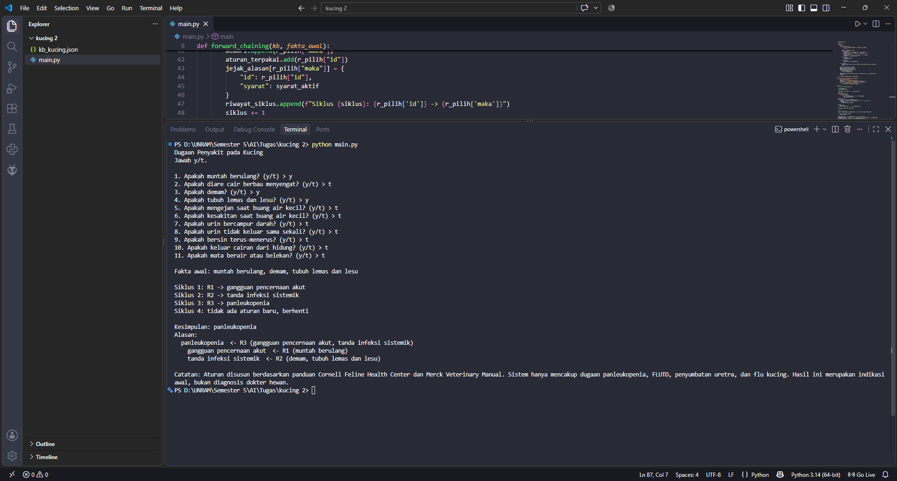
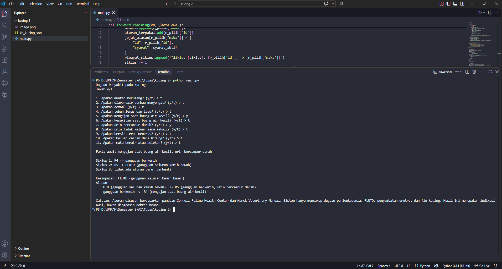
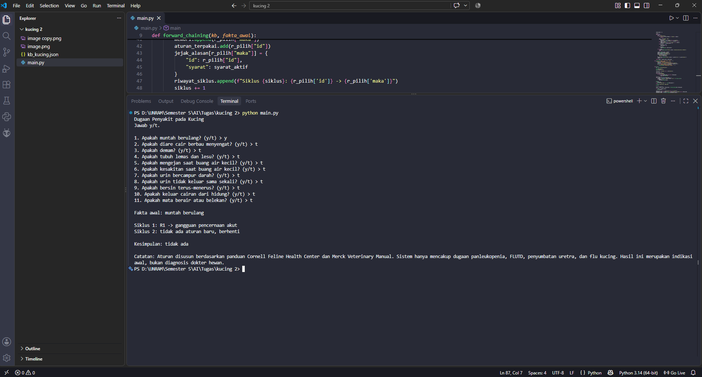

# Tugas 5 — Sistem Pakar Sederhana

- **Nama**: Lalu Galang Abdullah
- **NIM**: F1D02410064

## 1. Topik dan Cara Menjalankan Program

- **Topik**: Dugaan Penyakit pada Kucing (Panleukopenia, FLUTD, Obstruksi Uretra, dan Flu Kucing).
- **Bahasa & Versi**: Python 3 ke atas.
- **Perintah Menjalankan**:
  ```bash
  python main.py
  ```

## 2. Daftar Sumber dan Tabel Aturan

### Daftar Sumber

1. **S1**: *Feline Panleukopenia*, Merck Veterinary Manual, https://www.merckvetmanual.com/cat-owners/disorders-affecting-multiple-body-systems-of-cats/feline-panleukopenia, diakses 10 November 2026.
2. **S2**: *Feline Lower Urinary Tract Disease*, Cornell Feline Health Center (Cornell University College of Veterinary Medicine), https://www.vet.cornell.edu/departments-centers-and-institutes/cornell-feline-health-center/health-information/feline-health-topics/feline-lower-urinary-tract-disease, diakses 10 November 2026.
3. **S3**: *Feline Respiratory Disease Complex*, Merck Veterinary Manual, https://www.merckvetmanual.com/respiratory-system/respiratory-diseases-of-small-animals/feline-respiratory-disease-complex, diakses 10 November 2026.

### Tabel Aturan

| Aturan | IF | THEN | Sumber |
| :---: | :--- | :--- | :---: |
| **R1** | IF muntah berulang **OR** diare cair berbau menyengat | THEN gangguan pencernaan akut | S1 |
| **R2** | IF demam **AND** tubuh lemas dan lesu | THEN tanda infeksi sistemik | S1 |
| **R3** | IF gangguan pencernaan akut **AND** tanda infeksi sistemik | THEN panleukopenia | S1 |
| **R4** | IF mengejan saat buang air kecil **OR** kesakitan saat buang air kecil | THEN gangguan berkemih | S2 |
| **R5** | IF gangguan berkemih **AND** urin bercampur darah | THEN FLUTD (gangguan saluran kemih bawah) | S2 |
| **R6** | IF gangguan berkemih **AND** urin tidak keluar sama sekali | THEN penyumbatan saluran kemih (obstruksi uretra) | S2 |
| **R7** | IF bersin terus-menerus **OR** keluar cairan dari hidung | THEN gejala saluran napas atas | S3 |
| **R8** | IF gejala saluran napas atas **AND** mata berair atau belekan | THEN flu kucing (URI) | S3 |

## 3. Metode yang Dipilih dan Alasannya

- **Metode**: *Forward Chaining* (FC).
- **Alasan**: Penalaran bergerak maju dari sekumpulan fakta/gejala klinis awal yang diamati oleh pemilik kucing menuju kesimpulan penyakit. Metode ini dipilih karena memiliki  fakta yang berasal dari sumber untuk kemudian digunakan sebagai aturan guna menyimpulkan penyakit akhir.

## 4. Tiga Kasus Uji

### Kasus 1: Panleukopenia
- **Jawaban "y"**: muntah berulang, demam, tubuh lemas dan lesu.
- **Kesimpulan yang diharapkan**: panleukopenia.



### Kasus 2: FLUTD
- **Jawaban "y"**: mengejan saat buang air kecil, urin bercampur darah.
- **Kesimpulan yang diharapkan**: FLUTD.



### Kasus 3: Kasus Negatif (Tidak Menghasilkan Kesimpulan)
- **Jawaban "y"**: muntah berulang saja.
- **Kesimpulan yang diharapkan**: tidak ada.



## 5. Batas Keberlakuan

Aturan disusun berdasarkan panduan Cornell Feline Health Center dan Merck Veterinary Manual. Sistem hanya mencakup dugaan panleukopenia, FLUTD, penyumbatan uretra, dan flu kucing. Hasil ini merupakan indikasi awal, bukan diagnosis dokter hewan.

## 6. Penggunaan Alat Bantu AI

Menggunakan AI (Gemini) untuk membantu mencari sumber yang relevan dengan topik yang diangkat dan membantu memvalidasi kode yang dibuat.
